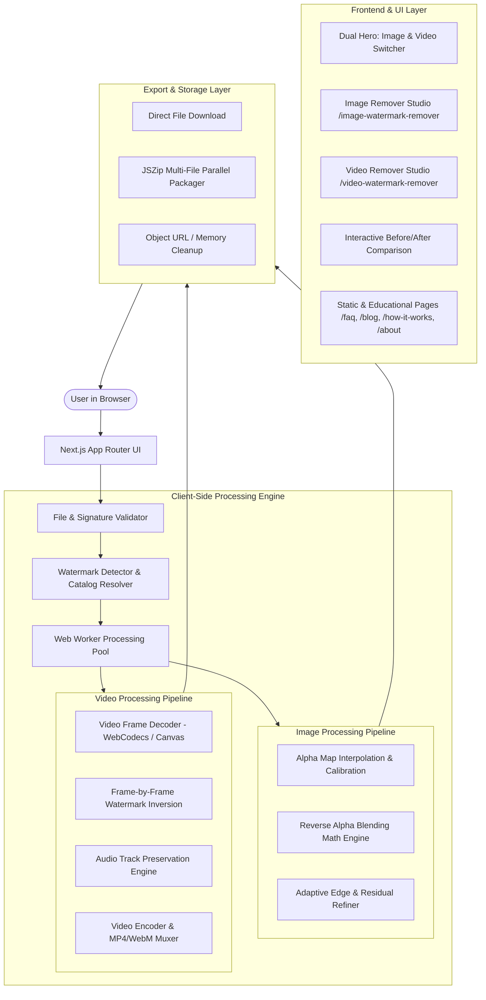

# Gemini Watermark Remover Pro: Architecture & Implementation Plan

**Project:** Gemini Image & Video Watermark Remover Pro  
**Version:** 1.0.0  
**Target Environment:** Modern Web Browsers (Chrome, Edge, Firefox, Safari)  
**Core Philosophy:** 100% Client-Side, Mathematically Exact, Lossless, Non-Destructive  

---

## 1. System Architecture Diagram

---

## 2. Technical Stack Specifications

### 2.1 Framework & Core
- **Framework:** Next.js (App Router, static export / hybrid client rendering).
- **Language:** TypeScript 5.x for complete type safety.
- **Styling:** Vanilla Tailwind CSS with custom HSL-tailored tokens, glassmorphism utilities, dark/light themes, and smooth micro-animations.
- **Icons & Graphics:** Lucide React icons + bespoke SVG watermark vectors.
- **Fonts:** Google Fonts `Plus Jakarta Sans` & `Inter` for modern typography.

### 2.2 Processing & Media
- **Image Processing:** Pure client-side `OffscreenCanvas` & `ImageData` array manipulation inside dedicated Web Workers.
- **Mathematical Inversion:** High-precision Reverse Alpha Blending with pre-calibrated 8-bit/16-bit alpha channels for all official Gemini aspect ratios and scales.
- **Video Decoding/Encoding:** HTML5 `<video>` frame extraction + Canvas 2D frame stream + WebCodecs API (`VideoDecoder` / `VideoEncoder`) with fallback to `MediaRecorder` + `mp4-muxer` / `webm-muxer`.
- **Audio Preservation:** Web Audio API (`AudioContext`) to preserve synchronized audio tracks.
- **Batch Packaging:** `jszip` for instant in-browser ZIP bundle creation.

---

## 3. Mathematical Foundations of the Watermark Engine

### 3.1 Forward Blending Model
When Google Gemini or Veo applies its visible watermark logo to an image or video frame, it composites a semi-transparent white logo overlay $L(x, y) = 255$ with an alpha map $\alpha(x, y) \in [0, 1]$ over the clean underlying image $I_{orig}(x, y)$:

$$I_{watermarked}(x, y) = \alpha(x, y) \cdot L + (1 - \alpha(x, y)) \cdot I_{orig}(x, y)$$

### 3.2 Exact Reverse Alpha Inversion
To recover the original pixel color channel $I_{orig}$ without generative hallucinations:

$$I_{orig}(x, y) = \frac{I_{watermarked}(x, y) - \alpha(x, y) \cdot L}{1 - \alpha(x, y)}$$

### 3.3 Boundary & Noise Handling
1. **Noise Floor Suppression:** When $\alpha(x, y) < 0.012$, pixels are unaffected; skip inversion to eliminate background quantization noise.
2. **Singularity Guard:** When $\alpha(x, y) \ge 0.98$, division by near-zero creates extreme amplification; clamp $\alpha$ to $0.98$ and apply bilateral boundary smoothing.
3. **8-Bit Clamping:** Ensure restored color channels adhere to valid color bounds:
   $$I_{restored} = \max(0, \min(255, \text{round}(I_{orig})))$$
4. **Adaptive Alpha Gain Multiplier:** Provide user-controllable and auto-calibrated gain factors $g \in [0.5, 1.8]$ to adjust for varying JPEG/WebP compression degradation.

---

## 4. Module Decomposition

### 4.1 Core Processing Modules (`src/lib/watermark/`)
- `geminiCatalog.ts`: Database of official Gemini image and video dimensions, aspect ratios, and corresponding watermark positions, margins, and sizes.
- `alphaMaps.ts`: Base64-encoded, compressed high-fidelity alpha templates for $36 \times 36$, $48 \times 48$, and $96 \times 96$ watermarks, with bilinear interpolation for custom scales.
- `imageProcessor.ts`: Core Reverse Alpha Blending loop operating on `Uint8ClampedArray` with auto-margin search and subpixel correlation.
- `videoProcessor.ts`: Video decoder, frame iterator, frame-by-frame alpha inversion, audio stream extractor, and MP4/WebM re-encoder.
- `fileValidator.ts`: Magic-byte and MIME-type verification, dimension inspection, and corrupt file rejection.
- `workerManager.ts`: Web Worker pooling for parallel multi-image and video processing.

### 4.2 Application Pages & Route Structure (`src/app/`)
- `/`: Master homepage with dual image/video hero, quick removal workbench, feature grid, interactive before/after gallery, FAQ accordion, and SEO sections.
- `/image-watermark-remover`: Focused studio workspace for single and batch image cleaning with zoom, pixel inspector, and manual ROI adjustment.
- `/video-watermark-remover`: Focused studio workspace for Gemini and Veo video watermark cleaning with video player, scrubber, and download manager.
- `/how-it-works`: Interactive mathematical explainer of Reverse Alpha Blending vs. AI inpainting, with live canvas visualizations.
- `/faq`: Comprehensive searchable FAQ covering formats, limitations, browser support, and troubleshooting.
- `/about`: Mission statement, open-source principles, technical privacy disclosures, and architecture overview.
- `/contact`: Functional contact and feedback form with local state handling.
- `/privacy-policy`: Legally verified client-side zero-retention privacy policy.
- `/terms`: Terms of service, open-source licensing, and fair-use guidelines.
- `/blog`: High-value educational articles list.
- `/blog/[slug]`: In-depth articles covering SynthID vs. visible watermarks, Veo video cleanup, lossless restoration, and developer workflows.
- `robots.txt` & `sitemap.xml`: Complete search engine crawling manifests.
- `not-found.tsx`: Custom branded 404 error page with quick navigation back to tools.
